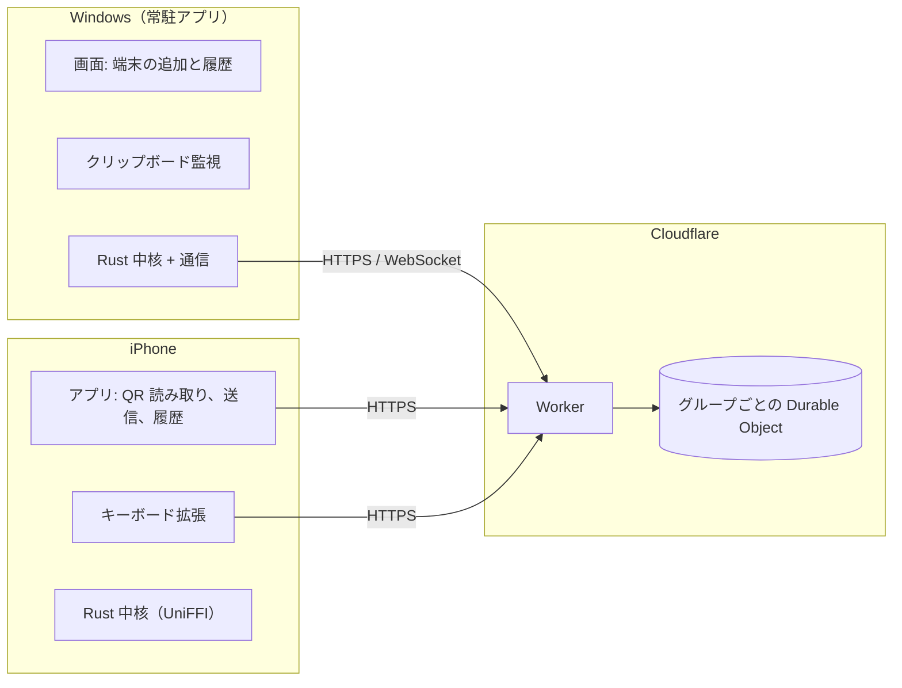

# enclip PoC のアーキテクチャ

この文書は、enclip の PoC で採った構成と、その判断の理由をまとめたものです。鍵の仕組みと安全性の保証は [crypto/key-protocol.md](crypto/key-protocol.md) を正本とし、ここでは扱いません。

## 目的と範囲

PoC の目的は、作者本人が Windows と iPhone の間でテキストを日常的に共有できるかを確かめることです。パスワードやワンタイムコードの受け渡しを主な使い方として想定しています。

PoC に含めるのは、QR コードによるペアリングと E2EE、Windows から iPhone への送信、iPhone から Windows への送信です。機密の自動判定と自動削除、パスワード欄への AutoFill、LAN 経由の通信は含めず、製品版で扱います。

## 全体構成

サーバーは暗号文を保存して配信するだけで、内容を読めません。暗号化と検証はすべて端末で行います。

## 構成要素と責務

| 構成要素 | 場所 | 責務 |
|---|---|---|
| プロトコル中核 | `crates/enclip-core` | 鍵の生成、ペアリングの手順、アイテムの暗号化と復号、重複と期限の判定。通信と保存は持たない |
| 通信 | `crates/enclip-client` | 中継サーバーの API、ペアリングの待ち受け、新着の取得。Windows アプリと開発用 CLI が使う |
| iOS 向けの橋渡し | `crates/enclip-ffi` | 中核を Swift から呼べるようにする（UniFFI）。iOS の通信は Swift の URLSession で行う |
| 中継サーバー | `apps/server` | 暗号文の保存と配信、ペアリング中のメッセージの受け渡し、アクセス用トークンの確認 |
| Windows アプリ | `apps/windows` | コピーの自動送信、受け取ったテキストの自動反映、端末の追加（QR 表示と承認）、履歴 |
| iPhone アプリ | `apps/ios/App` | QR の読み取りと確認コードの表示、ペーストボタンでの送信、履歴（タップでコピー） |
| キーボード拡張 | `apps/ios/Keyboard` | 開いたときに新着を取得し、最新数件をタップで入力する |

## データと正本

| データ | 正本 | 備考 |
|---|---|---|
| 端末鍵 | 各端末（Windows は DPAPI で保護したファイル、iPhone はキーチェーン） | 端末の外に出さない |
| ユーザー鍵、アクセス用トークン、グループ ID | グループを作った Windows。参加した端末は写しを持つ | ペアリングで新端末へ暗号化して渡す |
| アイテム（暗号文） | サーバー（グループごとの Durable Object の SQLite） | 連番を付けて保存し、期限を過ぎたら削除する |
| 受け入れた ID の記録と、観測した最新時刻 | 各端末 | 再送と期限切れを拒否するために使う（仕様 4.3） |
| 取得済みの連番 | 各端末 | 再接続したとき、この続きから取り直す |
| 履歴（平文） | 各端末 | iPhone は App Group の保存領域、Windows は PoC ではメモリだけ |

iPhone では、アプリとキーボード拡張が同じ保存領域とキーチェーンを使います。両方が同時に書かないよう、ファイルの読み書きは協調させています。

## 主な流れ

ペアリングでは、Windows が QR コードを表示し、iPhone が読み取って参加を申請します。両方の画面に出た確認コードを利用者が見比べ、Windows で承認すると、iPhone がユーザー鍵とアクセス用トークンを受け取ります。手順の詳細は仕様 4.1 にあります。

送信では、端末がアイテムを暗号化してサーバーへ送り、サーバーが連番を付けて保存します。サーバーは、接続中の端末へ WebSocket で新着を知らせます。

受信では、端末が取得済みの連番より後のアイテムを取得し、中核で検証して受け入れます。WebSocket の通知は「新しいものがある」合図として使い、中身は連番で取り直します。こうすると、接続が切れていた間のアイテムも取りこぼしません。

## 設計判断

### プロトコル中核を Rust で 1 つにする

暗号とペアリングの手順を Rust で 1 つだけ実装し、Windows と iPhone の両方で使います。端末ごとに実装を分けると、暗号の細部が食い違って相互に通信できなくなりやすく、形式検証した手順を 2 回実装することにもなるためです。共通化するのは暗号と手順だけで、通信、保存、OS との連携は各端末で作ります。

### Windows は Rust と Tauri で作る

中核と同じ言語にそろえるためです。Tauri は、タスクトレイと小さな画面（QR の表示と承認）を作れます。Windows 固有の処理（クリップボードと DPAPI）は分けてあり、開発中は Mac でも画面と同期を動かして確かめられます。

### サーバーはグループごとの Durable Object にする

同じグループへの書き込みが 1 か所に集まるので、アイテムの連番が単純に決まります。Windows へは WebSocket で即座に届けられ、待っている間は課金されません。当初の雛形にあった D1 は使わないことにしました。

### サーバーへのアクセスには、グループ ID とは別のトークンを使う

グループ ID は QR コードに載るので、盗み見た人も知っています。グループ ID だけで投稿を許すと、内容は読まれなくても、ゴミの投稿で配信を妨げられます。そこで、ユーザー鍵と一緒に暗号化して渡すトークンを、サーバーへのアクセスに使います。内容の秘匿と真正性は暗号が担い、トークンは安全性の保証には使いません。

### グループは Windows で作り、Windows が QR を表示する

PC にはカメラがないことが多いためです。

### Windows への自動反映は、手元のコピーより新しいときだけにする

届いたアイテムの作成時刻が、Windows で最後にコピーした時刻より新しい場合だけ、最新の 1 件をクリップボードへ入れます。スリープなどで接続が切れていた間に届いた古いアイテムが、直前にコピーした内容を上書きしないようにするためです。一時停止中のコピーも、この時刻に含めます。

### パスワード欄には、iPhone アプリの履歴からコピーして貼る

iOS のカスタムキーボードはパスワード欄で使えません。PoC では、アプリの履歴をタップしてコピーし、標準のキーボードで貼ります。パスワード欄へ直接入れる AutoFill は製品版で作ります。

### iOS のプロジェクトは XcodeGen で生成する

キーボード拡張と App Group を含むプロジェクトを、設定ファイル `apps/ios/project.yml` から生成します。Xcode のプロジェクトファイルを手で編集するより壊れにくいためです。XcodeGen は nix で一時的に使い、Mac 全体には入れません。

## 再検討する条件

- Windows の履歴を再起動後も残したくなったら、DPAPI で保護して保存する。
- iPhone で新着を即座に知りたくなったら、アプリにも WebSocket か通知を入れる。
- LAN 経由に対応するときは、通信を差し替えられるよう、中核と通信の境界を保つ。
- 端末を 1 台だけ外す仕組みや、アカウントによる復旧を入れるときは、鍵の構成から見直し、仕様と形式モデルを更新する。
